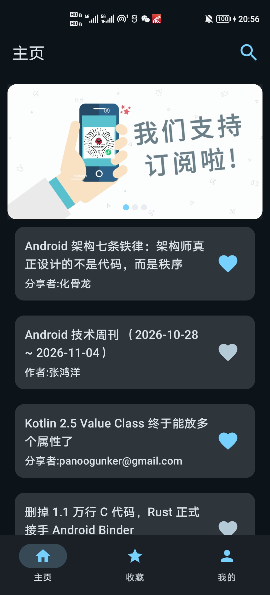
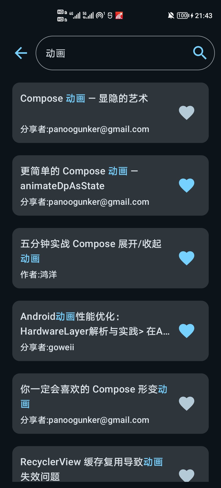
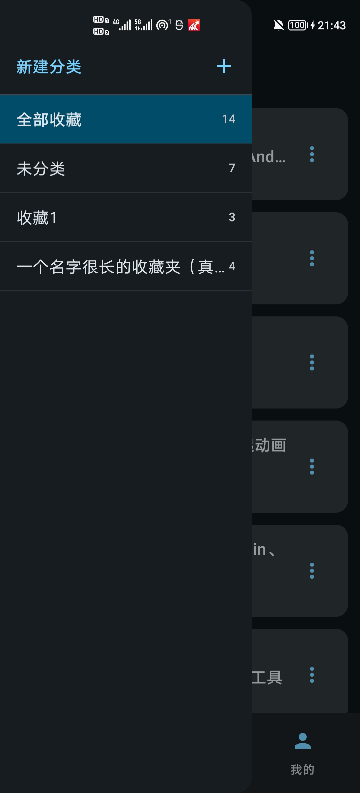
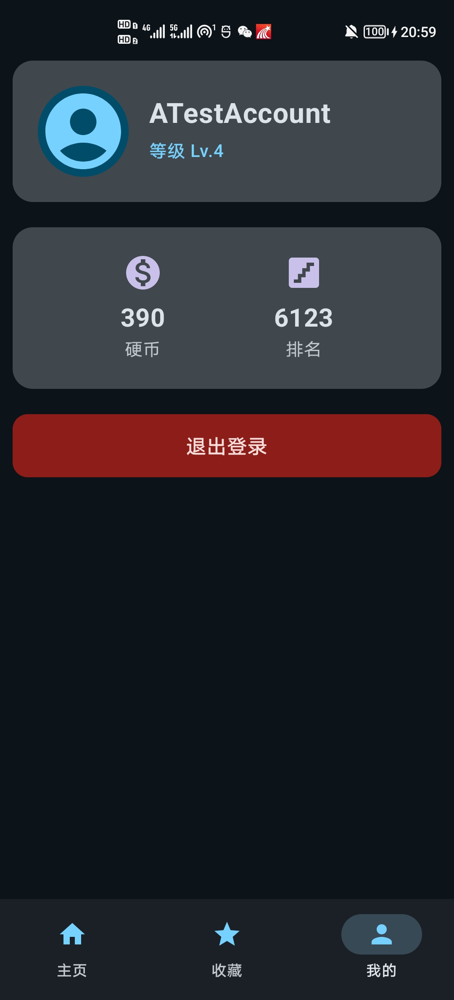

# WanAndroid 客户端

一个基于 **Jetpack Compose** 的玩 Android（[wanandroid.com](https://www.wanandroid.com)）第三方客户端，用于系统实践现代 Android 开发栈：Compose UI、MVVM + Repository、Paging 3、Room 离线缓存、WorkManager 后台同步，以及 Retrofit + kotlinx.serialization 网络层。

> **本项目为个人学习练习项目，非官方客户端，与玩 Android 官方无关。**
> 全部数据来自 [wanandroid.com](https://www.wanandroid.com) 提供的免费开放 API；文章内容版权归原作者所有，本应用仅展示标题、作者与原文链接，并通过系统浏览器打开原文。

| 首页 | 搜索 | 收藏 | 我的 |
| :---: | :---: | :---: | :---: |
|  |  |  |  |

## 功能

### 首页

- 顶部轮播图（Banner）：无限循环、自动轮播、拖拽时暂停、圆点指示器
- 文章列表：Paging 3 分页加载，含加载中 / 加载失败点击重试 / 没有更多等状态
- 列表内直接收藏 / 取消收藏，图标状态与收藏页实时同步

### 搜索
- 关键词搜索文章，分页加载与错误重试
- 标题中命中的关键词高亮显示，便于快速扫读
- 区分「未搜索」与「搜索无结果」两种空态，避免进入页面就出现无谓的加载动画
- 返回时自动清空搜索状态，释放上一次搜索结果

### 收藏（核心模块）
- 收藏列表支持按分类查看：全部收藏 / 未分类 / 自定义分类，通过侧边抽屉切换
- 分类管理：新建、重命名、删除；文章可移动到指定分类
- **本地优先**：收藏数据全部落 Room，断网可浏览，界面始终先响应本地数据
- **乐观 UI**：点收藏立即生效，网络请求交给 WorkManager 在后台执行，失败自动重试
- **下拉刷新对账**：拉取服务端全量收藏，同步网站端的收藏 / 取消收藏操作

### 我的
- 用户信息：用户名、积分、等级、排名
- 退出登录：清理 Cookie、取消该用户所有排队中的后台同步任务
- 退出瞬间保留最后一次用户信息渲染，避免页面在跳转前闪回默认值

### 账号
- 登录 / 注册，Tab 切换，状态驱动的加载与错误提示

### 浏览体验
- 文章详情使用 Custom Tabs 内嵌浏览器打开
- 自动补全站内相对链接（服务端对本站文章只返回 `/blog/show/xxx` 形式的路径）

## 技术栈

| 类别 | 选型 |
| --- | --- |
| 语言 / 构建 | Kotlin 2.0.21、AGP 8.9.1、Gradle 8.11.1、Java 11（编译目标） |
| UI | Jetpack Compose（BOM 2024.09.00）、Material 3、Navigation Compose 2.7.4 |
| 架构 | MVVM + Repository，StateFlow 单向数据流 |
| 网络 | Retrofit 2.9.0、OkHttp 4.12.0（日志拦截器）、converter-kotlinx-serialization 2.12.0 |
| 序列化 | kotlinx.serialization 1.8.1 |
| 本地存储 | Room 2.8.5（KSP 注解处理，导出 Schema） |
| 分页 | Paging 3.5.1（PagingSource + Compose 集成） |
| 后台任务 | WorkManager 2.12.0（唯一任务 + REPLACE 策略） |
| 图片 | Coil 2.4.0 |
| 浏览器 | AndroidX Browser 1.5.0（Custom Tabs） |
| 其他 | 自实现 `PersistentCookieJar` 完成 Cookie 持久化与登录态维持 |

SDK：`compileSdk = 35`、`targetSdk = 35`、`minSdk = 24`。

## 架构

整体是「分层 + 按功能分包」的混合结构：数据层按技术手段分层（本地 / 远程 / 仓库 / 同步），UI 层按功能聚合（首页 / 搜索 / 收藏 ……），改一个功能只进一个目录。

```
        ┌───────────── Compose UI（无状态组件 + Screen）─────────────┐
        │   HomeScreen   SearchScreen   CollectScreen   Mine / Login │
        └───────▲──────────────▲───────────────▲────────────────────┘
                │ StateFlow    │               │
        ┌───────┴──────────────┴───────────────┴────────────────────┐
        │ HomeViewModel  SearchViewModel  CollectViewModel  AuthVM  │
        └───────┬──────────────┬───────────────┬────────────────────┘
                │              │               │
                │      UserSessionRepository（登录态 / currentUserId）
                │              │               │
        ┌───────▼──────────────▼───────────────▼────────────────────┐
        │  ApiRepository          FavoriteRepository                │
        └───────┬──────────────────────┬────────────────────────────┘
                │                      │
        ┌───────▼────────┐    ┌────────▼─────────────────────────┐
        │ Retrofit/OkHttp│    │ Room（DAO + Entity）→ WorkManager │
        └────────────────┘    └──────────────────────────────────┘
```

几个设计取舍：

- **`UserSessionRepository` 是进程级单例**，唯一持有登录态、用户信息与派生的 `currentUserId`。多个 ViewModel 都需要"当前是谁"，把它下沉到数据层，避免 ViewModel 之间互相依赖。
- **ViewModel 按功能拆开**（`AuthViewModel` / `HomeViewModel` / `SearchViewModel` / `CollectViewModel`），各自只暴露自己页面用得到的 State，不存在一个几百行的"上帝 ViewModel"。
- **`ui/component` 里的组件不接收 ViewModel**，只收状态与回调（如 `ArticleItem(article, isCollected, onToggleFavorite)`），便于预览、复用与测试。
- **页面私有组件就近放在同一文件**（如 `MoveToCategorySheetContent`），跨页面共享的才提到 `ui/component`。

## 项目结构

```
app/src/main/java/com/study/wanandroid/
├── MainActivity.kt / WanAndroidApplication.kt   # 应用入口
├── common/                                      # 通用工具
│   ├── CustomTab.kt                             # Custom Tabs 封装（含站内相对链接补全）
│   ├── HtmlText.kt                              # 接口富文本标题 → 纯文本
│   └── ToastUtils.kt
├── data/
│   ├── local/                                   # 本地数据源
│   │   ├── AppDatabase.kt / Migrations.kt
│   │   ├── dao/                                 # FavoriteDao、CategoryDao
│   │   └── entity/                              # Room 表结构、RemoteSyncState
│   ├── remote/                                  # 远程数据源
│   │   ├── ApiService.kt                        # Retrofit 接口定义
│   │   ├── RetrofitClient.kt                    # OkHttp / Json / Retrofit 装配
│   │   ├── PersistentCookieJar.kt               # Cookie 持久化
│   │   ├── SessionEvents.kt                     # 全局未授权事件（401 / errorCode -1001）
│   │   ├── ArticlePagingSource.kt               # 首页文章分页数据源
│   │   └── dto/                                 # 网络响应模型（@Serializable）
│   ├── repository/
│   │   ├── ApiRepository.kt                     # 网络结果封装为 Result
│   │   ├── FavoriteRepository.kt                # 收藏业务（乐观 UI、对账）
│   │   └── UserSessionRepository.kt             # 登录态 / 用户信息（单例）
│   └── sync/
│       └── FavoriteSyncWorker.kt                # 收藏同步 Worker
└── ui/
    ├── AuthViewModel.kt                         # 登录 / 注册 / 退出
    ├── navigation/MainNav.kt                    # 导航图与登录态驱动跳转
    ├── component/                               # 跨页面复用组件
    │   ├── ArticleItem.kt / CarouselChart.kt
    │   └── ContentBottomBar.kt
    ├── home/      HomeScreen.kt + HomeViewModel.kt
    ├── search/    SearchScreen.kt + SearchViewModel.kt
    ├── collect/   CollectScreen.kt + CollectViewModel.kt + Category.kt
    ├── login/     LoginScreen.kt
    ├── mine/      MineScreen.kt
    └── theme/                                   # 主题、配色、字体
```

## 收藏模块设计要点

收藏是本项目里最复杂的部分，采用「本地优先 + 后台同步 + 全量对账」的策略。

**1. 三态同步状态机（`RemoteSyncState`）**

| 状态 | 含义 | 界面表现 |
| --- | --- | --- |
| `PENDING_ADD` | 本地已收藏，尚未上传成功 | 显示为已收藏 |
| `PENDING_DELETE` | 本地已取消，等待服务端同步 | 不显示 |
| `SYNCED` | 与服务端一致 | 显示为已收藏 |

状态流转由 `FavoriteRepository.toggleFavorite()` 驱动，界面只关心状态，不关心请求何时完成。

**2. 后台同步**

每次收藏 / 取消都会入队一个 `FavoriteSyncWorker`，使用 `enqueueUniqueWork(name, REPLACE)` 保证同一篇文章无论点多少次，最终只发一次符合最新状态的请求。网络失败走 `Result.retry()` 等待重试；登录失效则终止，由全局拦截器统一处理。

**3. 全量对账（下拉刷新）**

以服务端收藏列表（`lg/collect/list/{page}/json` 返回的 `originId` 集合）为准：拉取全部分页 → 合并详情（保留本地分类与收藏时间）→ 删除本地 `SYNCED` 但服务端已不存在的记录。比对在内存中完成，避免 `NOT IN` 拼接与 SQL 参数上限问题。

**4. 失败可见**

刷新失败会通过 Toast 暴露具体原因，而不是静默吞掉异常，便于定位网络或登录态问题。

## 踩坑记录

**`userInfo.collectIds` 在取消收藏后不可信。** 实测 `/user/lg/userinfo/json` 返回的 `collectArticleInfo.count` 与 `userInfo.collectIds` 的长度会不一致：在网站取消收藏后，`count` 和收藏列表接口都已更新，但 `collectIds` 会残留已删除的文章 id（"僵尸 id"）。因此本项目**不使用 `collectIds` 做对账依据**，一律以收藏列表接口的分页数据为准。

**站内文章链接是相对路径。** 服务端对本站文章只返回 `/blog/show/xxx` 这样的路径，直接 `Uri.parse()` 会得到没有 scheme 的 Uri，`CustomTabIntent.launchUrl()` 因找不到可处理的 Activity 而抛 `ActivityNotFoundException`。解决方式是在 `customTab()` 里统一判断 `scheme == null` 并补全域名，所有调用点一次覆盖。

**Room 的 schema 目录名跟着数据库类的全限定名走。** 移动 `AppDatabase` 的包会导致 KSP 往新目录输出 schema，历史版本需要手动归位，否则迁移测试拿不到旧版本 JSON。

**搜索接口的 `title` 是富文本。** `/article/query/{page}/json` 会把命中的关键词包成 `<em class='highlight'>关键词</em>` 返回，标题里的破折号等字符也是 `&mdash;` 这类 HTML 实体。原样塞给 `Text` 会把标签直接显示出来。处理分两层：数据层用 `HtmlCompat.fromHtml()` 剥标签、还原实体（`common/HtmlText.kt`）；UI 层不依赖服务端标记，由 `ArticleItem` 按关键词生成 `AnnotatedString` 染色。这样首页（接口本身没有标记）和搜索页表现一致，收藏表里存也始终是纯文本。

**个别记录的 `title` 自带摘要尾巴。** 实测有文章的 `title` 是「真实标题 `&gt;` 摘要片段」拼起来的，而原文标题里并没有 `>`——服务端入库时把描述拼进了标题字段。19 条搜索结果里只出现 1 条，客户端无法判断标题在哪个字结束，因此不做截断，原样展示。

## 快速开始

环境要求：

- Android Studio（Ladybug 或更新版本）
- JDK 11 及以上（项目 `jvmTarget = 11`，使用 Android Studio 内置 JDK 即可）
- Android SDK 35

```bash
git clone git@github.com:073-296/wanandroid-app.git
```

1. 用 Android Studio 打开项目，等待 Gradle Sync 完成
2. `local.properties` 由 Android Studio 自动生成（指向本机 SDK，不应提交到仓库）
3. 连接真机或启动模拟器，直接 Run

**国内网络提示**：`settings.gradle.kts` 中已预置阿里云 Maven 镜像（google / gradle-plugin / public），官方仓库作为兜底保留，通常无需额外配置代理。

**登录提示**：收藏、个人信息等接口需要登录态，请使用玩 Android 账号登录（没有账号可在应用内注册）。

## 已知问题

- 依赖第三方免费公开 API，可能存在限流、字段变更或偶发不可用
- 部分服务端字段可能返回 `null`，已在 `Json` 配置中开启 `coerceInputValues` 兜底
- 个别文章标题在服务端就带着「标题 `>` 摘要」的尾巴（接口返回的 `title` 字段本身如此），客户端无法可靠拆分，原样展示
- `MainViewModel` 拆分后每个页面各自订阅收藏状态，属于有意的取舍（同一 Room 查询的多次订阅，页面不可见即停止）
- 测试覆盖有限：项目以功能实践与架构验证为主，尚未补充完整的单元测试与 UI 测试
- 项目状态：核心功能已完成，处于低频维护状态

## 致谢

这个项目的每一行数据都不属于我，属于下面这些人。

**API 与平台**

- **[鸿洋](https://github.com/hongyangAndroid) 与玩 Android 团队**：长期提供**免费、稳定、无需申请**的开放 API，以及结构清晰的中文接口文档。个人开发者能拥有这样一个练手平台是非常幸运的事——没有 wanandroid，就没有这个项目。
  - 平台地址：<https://www.wanandroid.com>
  - 开放 API 文档：<https://www.wanandroid.com/blog/show/2>
  - 开源参考：<https://github.com/hongyangAndroid/wanandroid>

**文章作者与技术分享者**

玩 Android 本身是一个技术文章的聚合平台。首页、搜索结果和收藏列表里出现的每一篇文章，都来自不同开发者在掘金、CSDN、简书、个人博客、公众号等平台的原创或翻译分享——包括但不限于 Android 基础、架构设计、性能优化、Kotlin / Compose 实战、源码分析等方向的众多作者。

**感谢所有愿意把踩过的坑写下来的人。** 正是这些文章让后来者少走了很多弯路，也让这个练手项目有了真实可用的内容。本应用仅展示文章标题、作者与原文链接，并通过系统浏览器打开原文，**不抓取、不转载、不存储文章正文，全部内容版权归原作者及原发布平台所有**。若有作者不希望自己的文章出现在此类第三方客户端中，可通过仓库 Issue 联系，我会配合处理。

**开源库与工具**

- [Jetpack Compose](https://developer.android.com/jetpack/compose)、[Room](https://developer.android.com/training/data-storage/room)、[Paging 3](https://developer.android.com/topic/libraries/architecture/paging/v3-paging-overview)、[WorkManager](https://developer.android.com/topic/libraries/architecture/workmanager)、[Navigation](https://developer.android.com/guide/navigation)
- [Retrofit](https://square.github.io/retrofit/)、[OkHttp](https://square.github.io/okhttp/)
- [kotlinx.serialization](https://github.com/Kotlin/kotlinx.serialization)、[kotlinx.coroutines](https://github.com/Kotlin/kotlinx.coroutines)
- [Coil](https://coil-kt.github.io/coil/)
- [AndroidX Browser](https://developer.android.com/jetpack/androidx/releases/browser)（Custom Tabs）

感谢这些项目的维护者与贡献者，是他们的工作让 Android 开发变得可行且愉快。
